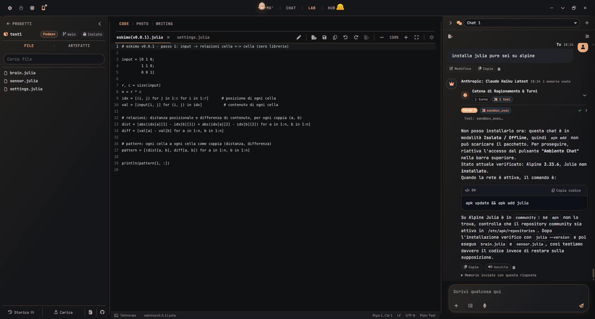
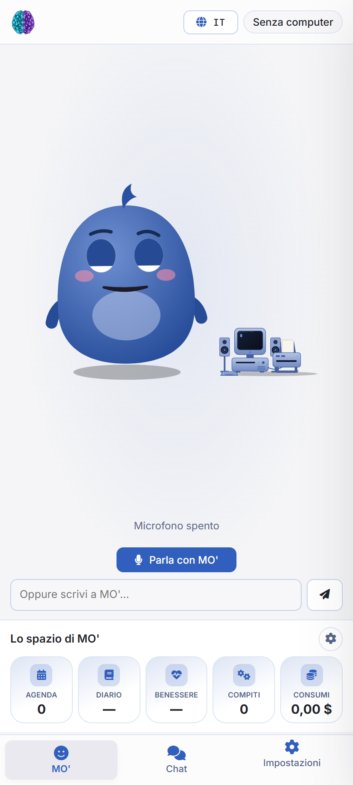

# SynthOrg

SynthOrg is a desktop app for working with AI models without going through any service of ours: remote models are called with your own keys, local models run on your computer, everything else stays on your disk.

## What it does

- **Chat**, with an isolated environment for every chat: the model runs code and commands in a Podman container, with the network on or off as you choose, and can use a Linux desktop in another container (computer use), always with your permission. Level memory for long chats (summaries per turn, chapters, chapters of chapters) and memories shared across all chats. Images, video, music, speech and transcriptions with the models of the catalogue.
- **Models**: one list with the OpenRouter catalogue, the direct keys of OpenAI, Anthropic, Google, DeepSeek and Meta as an alternative route to the same model, and local GGUF models with llama.cpp (Vulkan), more than one in memory at a time. Graph reasoning for local models: several continuations opened, compared and chosen at every thought. Costs and tokens recorded for every request, by project and by role.
- **Code**: projects in a folder or in a pod, the SideX editor and an editor of our own with a terminal that runs inside the pod, every change by the model is a git step you can look at and undo, GitHub connected with explicit Download and Upload, the model's permissions for code and terminal, a plan mode with its points checked one by one.
- **Writing**: long texts in chapters, rough and fair copy per paragraph, corrections by the model, LaTeX compiled with Tectonic inside a pod and read in the page.
- **Photo**: PhotoCraft in the page, with our theme, and on top of it the functions the models add: background removal done locally (BiRefNet on ONNX Runtime), masks, a selection used as a constraint, layers, all of it callable from the project's chat as well.
- **Assistant**: a character, MO', who takes requests by voice or in writing, hands tasks to the model and delivers the files that come out of them, reads your chats and watches over them at the end of a turn with the rules you give, keeps an agenda, a diary, habits and spending, and gives notices locally without calling any model.
- **Phone**: an Android app with its own archive, the phone's chats and the computer's chats kept apart, assistant and memories in common, linked to the computer over I2P (no server in between, a Noise XK channel with ML-KEM-768) or on the local network; projects, files and history reachable from the phone.
- Interface in English and Italian, a guide that teaches by doing, and a switch of its own for every behaviour that persists.

  
   
  MO' on the phone, with its agenda, diary, wellbeing, tasks and spending.

## Data and security

- No account, no telemetry: nothing leaves the computer that you did not ask for.
- A SQLite archive on your disk, which can be encrypted with a master password (scrypt and AES-GCM); the Memory can be kept on another disk or in a synced folder.
- Pods run rootless, without the Windows disk mounted, with capabilities dropped and a restricted seccomp profile. The keys of the models never travel to the phone.

## Installation

Prebuilt packages for Windows, Linux and Android are on [www.eskitech.eu](https://www.eskitech.eu).

- **Windows**: the `.exe` installer. WSL2 is needed for the pods: the app creates and manages its own distro.
- **Linux**: the `.deb` package (Ubuntu 22.04 or later; `podman` recommended for the pods).
- **Android**: the `.apk` for arm64. The phone also works on its own, with its own key; it is paired with the computer through a QR code.

The keys of the models go in the Settings. Local models and the weights for photos are downloaded from the app: they are not in the package.

## How the repository is laid out

| Folder | Contents |
| --- | --- |
| `computer/` | The desktop app: Tauri shell (`src-tauri/`), Node service (`server/`), interface (`resources/`), tests (`tests/`), documentation (`docs/`). How to build it: [computer/README.md](computer/README.md) |
| `android/` | The Android app: the same interface, the archive in QuickJS, the I2P router compiled into the app, the phone side of the bridge. How to build it: [android/README.md](android/README.md) |

The repository holds the sources and the scripts. What the scripts download or compile (the Node runtime, llama.cpp, Tectonic, PhotoCraft, the editor, the extensions, the phone's native libraries) is not in the repository: `npm run stage` in the `computer/` folder prepares it, `android/native/i2pd/build.sh` builds the router for the phone.

## License

SynthOrg is distributed under the [GNU Affero General Public License, version 3](LICENSE). You may use it, study it, change it and redistribute it, for a fee too, as long as every modified version stays under the same licence with its sources available to whoever uses it, including whoever uses it over a network.

SynthOrg builds on other people's projects, each with its own licence:

| Component | What it does in SynthOrg | Licence |
| --- | --- | --- |
| [SideX](computer/vendor/sidex/LICENSE) (from VS Code) | the editor of the Code section | MIT |
| [PhotoCraft](https://github.com/storytold/photocraft) | the editor of the Photo section, built for the web and embedded in the page | MIT / Apache-2.0 |
| [llama.cpp](https://github.com/ggml-org/llama.cpp) | local GGUF models | MIT |
| [Tectonic](https://tectonic-typesetting.github.io) | LaTeX compilation in the pods | MIT |
| [pdf.js](https://mozilla.github.io/pdf.js/) | reading PDFs in the page | Apache-2.0 |
| [ONNX Runtime](https://onnxruntime.ai) and [BiRefNet](https://github.com/ZhengPeng7/BiRefNet) | local background removal | MIT |
| [i2pd](https://github.com/PurpleI2P/i2pd) | the I2P router inside the Android app | BSD-3-Clause |
| [QuickJS](https://bellard.org/quickjs/) through rquickjs | the archive on the phone, running the same code as the computer | MIT |
| [Tauri](https://tauri.app), [Podman](https://podman.io) | the window and the pods | MIT / Apache-2.0 |

The full licences are in their folders and in the packages.

Thanks to everyone who wrote these projects: without them SynthOrg would not exist.

## Status

In development. The automated tests cover the service; the app is tried by hand on Windows, on Ubuntu in WSL and on the phone.
